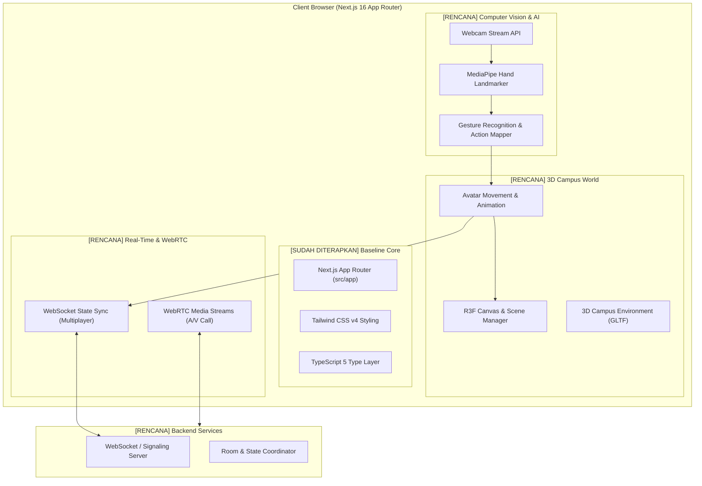

# Arsitektur Sistem CampusVerse AI

> **Dokumen Arsitektur Resmi Proyek CampusVerse AI**
> Status Dokumen: Hidup (*Living Document*) — Diperbarui seiring perkembangan modul.

---

## 1. Ikhtisar Arsitektur

CampusVerse AI dirancang sebagai platform kampus virtual terdistribusi berbasis web yang memadukan rendering grafika 3D, kecerdasan buatan untuk computer vision dari webcam, sinkronisasi multiplayer real-time, serta konferensi audio/video.

Arsitektur dibagi secara tegas antara **komponen yang sudah diimplementasikan (*Implemented*)** dan **rencana arsitektur masa depan (*Planned*)**.

---

## 2. Diagram Arsitektur Tingkat Tinggi



---

## 3. Rincian Komponen Arsitektur

### 3.1. Komponen yang Sudah Diterapkan (`IMPLEMENTED`)

| Komponen | Teknologi | Lokasi Berkas | Keterangan |
|---|---|---|---|
| **App Routing & Entrypoint** | Next.js 16.4.1 (App Router) | `src/app/layout.tsx`, `src/app/page.tsx` | Struktur aplikasi modern berbasis server dan client components |
| **Type Safety Layer** | TypeScript 5.x | `tsconfig.json`, `next-env.d.ts` | Konfigurasi ketat (*strict mode*) dan path alias `@/*` |
| **Design & Utility Styling** | Tailwind CSS v4 | `src/app/globals.css` | Engine styling modern berbasis CSS variables dan turbopack import |
| **Code Quality & Linter** | ESLint 9 | `eslint.config.mjs` | Konfigurasi flat modern untuk aturan Next.js dan TypeScript |
| **Bundler & Build Pipeline** | Turbopack | `next.config.ts` | Kompilasi ultra-cepat untuk development dan production build |

### 3.2. Komponen Rencana Arsitektur (`PLANNED`)

#### A. Lapisan 3D Virtual Campus (`Planned`)
- **Tujuan**: Menampilkan dunia kampus 3D yang dapat dijelajahi pengguna.
- **Pustaka Rencana**: Three.js, `@react-three/fiber`, `@react-three/drei`.
- **Rencana Struktur**:
  ```text
  src/
  ├── components/
  │   └── canvas/
  │       ├── CampusScene.tsx      # Scene 3D utama
  │       ├── CampusBuildings.tsx  # Gedung dan lingkungan kampus
  │       ├── Avatar.tsx           # Model avatar pengguna
  │       └── Lighting.tsx         # Pencahayaan dan bayangan
  ```
- **Pertimbangan Efisiensi**: Optimasi geometri model 3D (format `.glb` terkompresi Draco/Meshopt) agar tidak membebani kapasitas RAM 8 GB.

#### B. Lapisan Pengolahan Citra & AI Gestur (`Planned`)
- **Tujuan**: Membaca webcam pengguna secara lokal di browser dan mengenali gestur tangan untuk mengendalikan avatar atau berinteraksi di kampus virtual.
- **Pustaka Rencana**: `@mediapipe/tasks-vision` (Hand Landmarker).
- **Rencana Struktur**:
  ```text
  src/
  ├── features/
  │   └── vision/
  │       ├── WebcamFeed.tsx       # Komponen penampil video/kamera mini
  │       ├── useHandTracking.ts   # Hook inisialisasi & inference MediaPipe
  │       └── gestureClassifier.ts # Logika pengenalan gestur (wave, thumbs-up, dll)
  ```
- **Pertimbangan Performa**:
  - Pemrosesan citra dilakukan sepenuhnya *client-side* melalui WebGL/Wasm.
  - *Throttling frame rate* kamera (misal 15–20 fps) agar menghemat daya komputasi CPU/GPU.

#### C. Lapisan Real-Time Multiplayer (`Planned`)
- **Tujuan**: Menyelaraskan koordinat posisi, rotasi, dan gestur antar-mahasiswa dalam satu ruangan kampus virtual.
- **Pustaka Rencana**: Socket.IO / Native WebSocket.
- **Rencana Struktur**:
  ```text
  src/
  ├── features/
  │   └── multiplayer/
  │       ├── useMultiplayerSocket.ts
  │       └── networkInterpolation.ts
  ```

#### D. Lapisan Konferensi Audio/Video (`Planned`)
- **Tujuan**: Memungkinkan panggilan video/audio tatap muka (misal saat avatar saling berdekatan dalam radius tertentu atau di ruang kelas virtual).
- **Pustaka Rencana**: WebRTC PeerConnection API.
- **Rencana Struktur**:
  ```text
  src/
  ├── features/
  │   └── webrtc/
  │       ├── WebRTCManager.ts
  │       └── ProximityAudio.ts    # Spatial audio sesuai jarak avatar
  ```

---

## 4. Pola Direktori yang Direkomendasikan untuk Pengembangan Lanjutan

Untuk menjaga keteraturan kode saat modul-modul rencana mulai diimplementasikan, arsitektur folder `src/` disepakati menggunakan struktur *Feature-First*:

```text
src/
├── app/                  # Rute dan halaman Next.js
├── components/           # Komponen UI global (Button, Modal, Card, Layout)
├── features/             # Modul fungsional spesifik
│   ├── campus-3d/        # Kode 3D, model, kamera
│   ├── vision-ai/        # Webcam, MediaPipe, logika gestur citra
│   ├── multiplayer/      # Sinkronisasi posisi avatar
│   └── conferencing/     # WebRTC video/audio call
├── hooks/                # Custom React hooks bersama
├── lib/                  # Utilitas eksternal, konfigurasi klien
└── types/                # Definisi antarmuka TypeScript bersama
```

---

## 5. Ringkasan Matriks Arsitektur

| Domain | Sub-sistem | Status Saat Ini |
|---|---|---|
| **Pondasi Aplikasi** | Next.js 16 App Router | ✅ **IMPLEMENTED** |
| **Bahasa & Tipe** | TypeScript 5 | ✅ **IMPLEMENTED** |
| **Styling** | Tailwind CSS v4 | ✅ **IMPLEMENTED** |
| **Grafika 3D** | Three.js / React Three Fiber | ⏳ **PLANNED** |
| **Pengolahan Citra** | HTML5 Webcam API | ⏳ **PLANNED** |
| **AI Computer Vision** | MediaPipe Hand Tracking | ⏳ **PLANNED** |
| **Jaringan Real-Time** | WebSocket Multiplayer Sync | ⏳ **PLANNED** |
| **Komunikasi Suara/Video**| WebRTC Conference | ⏳ **PLANNED** |
